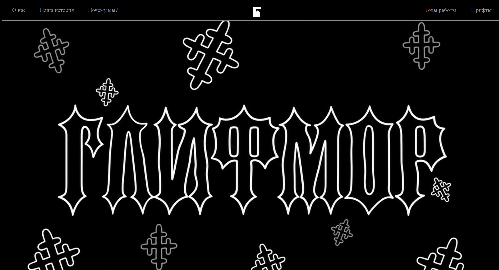

# fontcemeteryproject

# [Название сайта]

[Одно-два предложения: о чём этот сайт.]

## Ссылка на сайт

[https://ваш-логин.github.io/название-репозитория/]

## Скриншот

## Автор

[Имя Фамилия, группа]

## Что я научился(ась) делать

- [Что получилось]
- [Что было трудно и как справились]
- [Что узнали нового]

## Использование ИИ

### Инструменты

| Инструмент | Для чего использовал(а) | Уровень помощи |
| ---------- | ----------------------- | -------------- |
| [ ]        | [ ]                     | [ ]            |

### Записи о запросах

#### Запись №1 · [дата]

- **Что я хотел(а) сделать:** [ ]
- **Что я спросил(а):** [ ]
- **Что ответил ИИ:** [ ]
- **Что я изменил(а) сам(а):** [ ]
- **Как я понял(а), что это работает:** [ ]

### Выводы

[3–5 предложений: в чём ИИ помог, ошибался ли он, что теперь умеете сами.]
